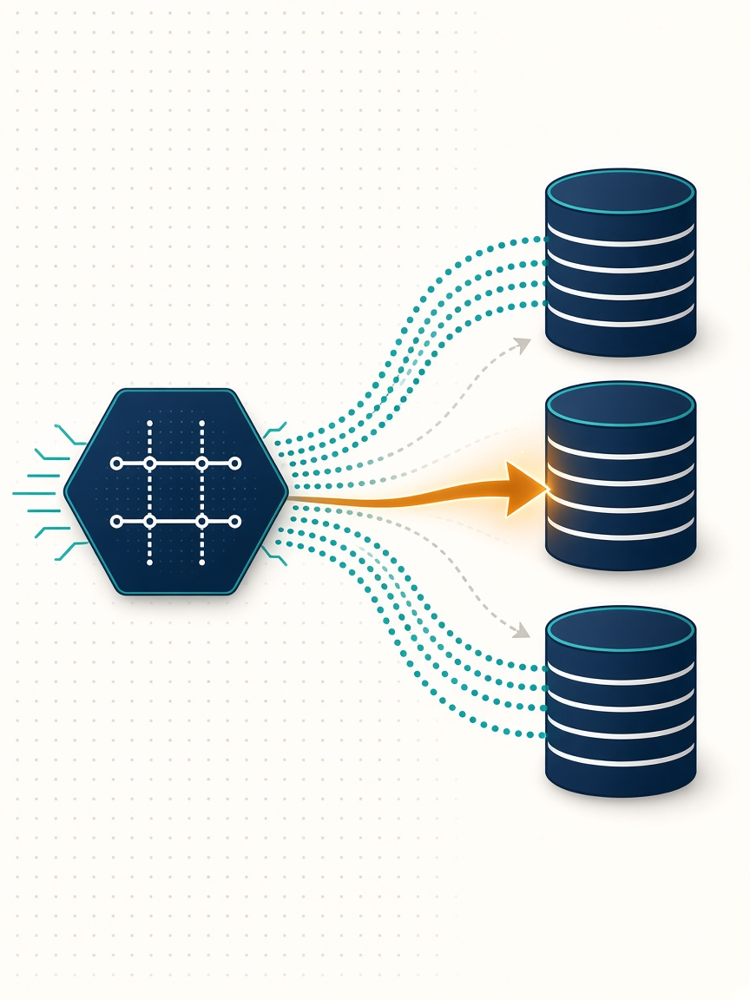
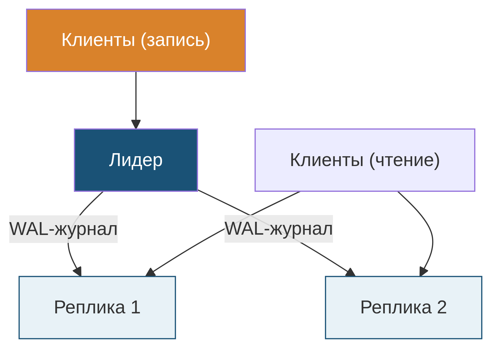

<style>
section { font-size: 26px; }
h1 { color: #1a5276; }
h2 { color: #1a5276; }
table { font-size: 22px; }
code { font-size: 20px; }
</style>

<!-- _class: lead -->


<style scoped>
section { color: #fff; }
h1, h2 { color: #fff; text-shadow: 0 2px 10px rgba(0, 0, 0, 0.55); }
</style>

# Распределенные базы данных
## Лекция 1. От централизованной СУБД к распределенной БД

Б1.В.07.02 · группа 02121-ДМ · 1 семестр

---

<!-- _class: lead -->


<style scoped>
h2 { font-size: 28px; }
</style>

# Цыдыпов Илья

## Инструмент, который хочу освоить: Kubernetes и MongoDB
## Где я уже встречал распределенные системы: пока не работал напрямую

Junior Python-backend (Django, FastAPI) · ИГУ, ФБКИ

---

## Мои 3+3

<style scoped>
section { font-size: 24px; }
h3 { font-size: 26px; margin: 6px 0; }
.expect { background: #e8f2f7; border-left: 6px solid #1a5276; padding: 6px 14px; margin: 4px 0; }
.fear   { background: #fdf1e3; border-left: 6px solid #d9822b; padding: 6px 14px; margin: 4px 0; }
.expect p, .fear p { margin: 2px 0; }
</style>

### Ожидания от курса

<div class="expect"><strong>Ожидаю</strong>: понять, как устроены распределенные БД</div>

<div class="expect"><strong>Ожидаю</strong>: научиться выбирать архитектуру под задачу</div>

<div class="expect"><strong>Ожидаю</strong>: увидеть реальные кейсы применения РБД</div>

### Опасения

<div class="fear"><strong>Боюсь</strong>: не хватит практики для закрепления материала</div>

<div class="fear"><strong>Боюсь</strong>: будет сложно представить работу системы целиком</div>

<div class="fear"><strong>Боюсь</strong>: тяжело будет разобраться в сценариях отказа</div>

---

## Курс: организация

| Параметр | Значение |
|---|---|
| Лекции | 8 ч (4 занятия) |
| Практические занятия | 6 ч (3 занятия: Docker/Postgres, SQL/Spark, MongoDB) |
| Отчетность | отчеты по ПЗ, итоговый тест, зачет (2,2 ч) |
| Инструменты | Docker, PostgreSQL, PySpark, MongoDB |

**Логика курса**: зачем распределять → как согласовать → на чем хранить и считать → как строить хранилища.

---

## План лекции

1. Почему одной машины становится мало
2. Вертикальное и горизонтальное масштабирование. Архитектуры
3. Распределенная БД: определение, виды прозрачности
4. Фрагментация (шардирование): виды, правила корректности, выбор ключа
5. Репликация: синхронная/асинхронная, single-leader / multi-master
6. CAP и PACELC. ACID против BASE
7. Разбор кейсов: интернет-магазин, гео-распределенный банк

---

## Данные растут быстрее машины

- Онлайн-торговля: миллионы заказов в день, история — годы
- IoT и логи: тысячи событий в секунду с каждого устройства
- Банки: 24/7, простой = деньги и репутация
- Аналитика: полные перезаливы «всех данных» регулярно

**Вопрос**: что случится, когда данные перестанут помещаться на один диск? А когда нагрузка — в один CPU?

<!-- [Вопрос] Что сломается первым, если таблица заказов вырастет в 100 раз? Дать 15–20 секунд тишины.
     [История] Медленные страницы = ушедшие пользователи; БД определяет жизнь бизнеса. -->

---


## Четыре ограничения одной машины

| Ограничение | Симптом |
|---|---|
| Диск | таблица > диска; бэкапы длятся сутки |
| RAM | индексы не влезают — план «уходит» на скан |
| CPU | запросы в очереди, OLTP страдает от OLAP |
| Сеть | клиенты далеко: задержка 100+ мс |

Плюс **пятая проблема**: выход из строя единственного сервера = остановка бизнеса.

---


## Отказоустойчивость и география

- **HA (high availability)**: сервер умирает → система живет
  - время восстановления (MTTR) и простой стоят денег
- **Геораспределенность**: пользователь из Владивостока не должен ходить за данными в Москву
- **Гео-резерв**: пожар в дата-центре не должен останавливать сервис

→ Естественный ответ: **несколько серверов, работающих как одно целое**

<!-- [История] Amazon S3, 2017: ошибка вывода серверов из кластера уронила доступность части интернета на полдня — данные целы, сервис недоступен. -->

---


## Масштабирование: вертикальное vs горизонтальное

<style scoped>
section { font-size: 21px; }
h2 { font-size: 30px; }
table { font-size: 18px; }
</style>

| | Вертикальное (scale-up) | Горизонтальное (scale-out) |
|---|---|---|
| Как | мощнее сервер | добавляем узлы |
| Лимит | потолок железа, цена растёт | практически нет |
| Приложению | прозрачно | нужны шардирование и репликация |
| Отказ | кластер = один сервер | теряется часть мощности |
| ПО | любая СУБД | нужна распределённая СУБД |

---


## Архитектуры многопроцессорных систем

- **Shared-memory** — много CPU, одна память. Масштаб — до десятков ядер
- **Shared-disk** — CPU у каждого, диск общий (SAN). Спор за диск — bottleneck
- **Shared-nothing** — у узла свои CPU + память + диск; связь по сети
  - каждая таблица (фрагмент) живет на конкретном узле
  - масштабируется почти линейно
  - **основная архитектура распределенных БД** (Cassandra, ClickHouse, шардированные РСУБД, Spark)

---


## Что такое распределенная БД

**Распределенная БД** — логически единая база данных, физически размещенная на нескольких узлах, соединенных сетью.

Ключевое слово — **логически единая**:
- пользователь пишет обычный SQL / обычные запросы;
- система сама решает, на каком узле лежат данные и куда отправить запрос.

Примеры: Cassandra, ClickHouse-кластер, CockroachDB, MongoDB-шардированный кластер, Spanner.

---

## Виды прозрачности (transparency)

| Прозрачность | Пользователь не знает... |
|---|---|
| местоположения | на каком узле данные |
| фрагментации | что таблица разбита на части |
| репликации | что копий несколько |
| транзакций | что транзакция задела несколько узлов |
| схемы | что данные разнородны (полиглотность) |

**Компромисс**: чем выше прозрачность, тем больше работы система берёт на себя — и тем труднее локализовать сбой, когда что-то идёт не так.

<!-- ИИ: черновик текста, отредактировано вручную -->

---


## Эталонная архитектура распределенной БД

```
Глобальная схема (logical)
   ├── Фрагмент 1 ── Узел A (шард 1, лидер)
   ├── Фрагмент 2 ── Узел B (шард 2, лидер)
   │                   ├── реплика шард 2 (узел C)
   ...
   └── Каталог распределения: где что лежит (метаданные)
```

Две ортогональные техники:
- **фрагментация** — делим данные на **непересекающиеся** части;
- **репликация** — делаем **копии** частей на разных узлах.

---

<!-- _class: lead -->

# Фрагментация (шардирование)

---


## Горизонтальная фрагментация

Строки одной таблицы делятся по узлам по правилу:

```sql
-- Узел East:  shard_east
SELECT * FROM orders WHERE customer_region = 'east';
-- Узел West:  shard_west
SELECT * FROM orders WHERE customer_region = 'west';
```

- Естественна для «событийных» таблиц: заказы, платежи, логи
- Правило разбиения = **ключ шардирования** (shard key)
- Каждый шард — обычная таблица/база со своей схемой

---

## Вертикальная и гибридная фрагментация

**Вертикальная** — по столбцам:
- `customers_profile(id, name, city)` — узел A (часто читается CRM);
- `customers_activity(id, last_login, counters)` — узел B (нагревается аналитикой).

**Гибридная** — сначала по строкам, затем по столбцам (или наоборот).

На практике горизонтальная фрагментация — основной случай; вертикальную чаще применяют как **разделение сервисов** (микросервисные БД).

---

## Правила корректности фрагментации

Классика (Ceri, Pelagatti, Özsu–Valduriez):

1. **Полнота**: каждая строка исходной таблицы попадает хотя бы в один фрагмент
2. **Восстановимость** (reconstruction): из фрагментов можно восстановить исходную таблицу (UNION для горизонтальной, JOIN для вертикальной)
3. **Непересечение**: строка не принадлежит двум горизонтальным фрагментам (иначе — дубли и рассинхрон)

Нарушение любого = данные «теряются» или «удваиваются».

---

## Стратегии шардирования: range / hash / list

<style scoped>
section { font-size: 21px; }
h2 { font-size: 30px; margin-bottom: 8px; }
table { font-size: 18px; }
</style>

| Стратегия | Как | Плюсы | Минусы |
|---|---|---|---|
| Range | диапазоны ключа | быстрые range-сканы | горячие зоны, перекосы |
| Hash | `hash(key) % N` | равномерность | диапазоны идут во все шарды |
| List | список значений (регион) | локальность, GDPR | шарды разного размера |

**Каталог** хранит: shard → узел → диапазон ключей.

---

<!-- prompt: STYLE: flat modern tech infographic illustration, clean vector style, deep navy blue and teal palette with warm amber accents on light background, subtle dotted grid, soft shadows, professional textbook look, no text, no letters, no numbers. SCENE: three database shards as stacked-cylinder icons; a central navy hexagon represents the hash function and sends evenly spaced key tokens to all three shards; one highlighted amber query arrow hits exactly one shard, while faded teal arrows show scatter-gather to the others; the chosen shard glows amber. Vertical composition, free space at the top for text. -ar 3:4 -->


## Хороший ключ шардирования

<style scoped>
section { font-size: 22px; }
</style>

Ключ хорош, если:

1. **Высокая кардинальность** — много различных значений
2. **Равномерное распределение** — нет «жирного» значения
3. **Изоляция запросов** — типичный запрос несет ключ:
   `WHERE customer_id = ?` → попадает в **один** шард

Антипримеры:
- `gender` (2 значения), `status` (5 значений) — один горячий шард
- монотонно растущий `created_at` — все вставки в последний шард
- `country` при 90% строк из одной страны

---


## Болезни шардирования

- **Hotspot (горячий шард)** — один узел принимает большую часть записей
  - лечится: смена ключа, hash-стратегия, salting (префикс случайным суффиксом)
- **Skew (перекос данных)** — шарды формально равны по числу строк, но не по объему/нагрузке
- **Scatter-gather** — запрос без ключа шардирования идет на **все** шарды:
  `WHERE email = ?` при шардировании по `customer_id` → Fan-out × N
- **Кроссшардовые JOIN и транзакции** — сложно и дорого (тема лекции 2)

---

<!-- _class: lead -->

# Репликация

---

## Зачем нужна репликация

1. **Отказоустойчивость**: лидер умер → реплика становится лидером (failover)
2. **Масштабирование чтения**: читаем с ближайшей/наименее загруженной реплики
3. **Латентность**: копия рядом с пользователем
4. **Изоляция нагрузок**: аналитика уходит на реплику, OLTP не страдает

Репликация **не заменяет** бэкап: случайно удаленные на лидере данные удалятся и на репликах.

---


## Синхронная и асинхронная репликация

<style scoped>
section { font-size: 24px; }
table { font-size: 20px; }
</style>

| | Синхронная | Асинхронная |
|---|---|---|
| COMMIT | ждет подтверждения реплики(й) | сразу, журнал уходит позже |
| Потеря данных при отказе | нет (1 реплика синхр.) | возможна (лаг) |
| Задержка записи | рост с RTT | минимальна |
| Отказ реплики | блокирует запись | запись продолжается |

На практике: **полусинхронная** — ждать k подтверждений (PostgreSQL `synchronous_commit`, MySQL semi-sync).

---

<!-- Mermaid-исходник: leader_topology.mmd -->


## Single-leader (master–slave)

- Запись — **только на лидере**; реплики read-only
- Перенос журнала: WAL (Postgres), binlog (MySQL), oplog (MongoDB)
- **Failover**: реплика повышается до лидера; старый лидер отсекается (split-brain — тема Л2)
- Клиенты чтения ходят в реплики, не нагружая лидера

<!-- Спросить зал: что будет, если сеть мигнула и поднялись два лидера?
     Развернуть: split-brain, «две бухгалтерии». -->

---


## Multi-master (leaderless / multi-leader)

- Писать можно на **любой** узел; изменения распространяются между узлами
- Плюс: запись масштабируется, переживает отказ узла и сетевые разделения
- Минус: **конфликты записей**

```
Клиент A: UPDATE t SET x = x + 1  ──►  Узел 1
Клиент B: UPDATE t SET x = x + 1  ──►  Узел 2
Оба изменения применены локально → при синхронизации x увеличился дважды?
или одно потеряно?  ── нужен механизм разрешения
```

Разрешение: last-write-wins (по часам!), CRDT, версионные векторы, разрешение на клиенте.

---

## Согласованность реплик (набросок)

- **Eventual consistency**: реплики сходятся к одному состоянию, **если записи прекратились**; но когда — не гарантировано
- **Read-your-writes**: пользователь всегда видит собственную запись
  - «оплатил — а в кабинете платеж пропал» — классика асинхронной репликации
- **Monotonic reads**: прочитав новое — не прочтешь потом старое
  (достигается session-sticky чтением с одной реплики)

Подробно — лекция 2.

---

<!-- _class: lead -->

# CAP и PACELC

---


## CAP-теорема

<style scoped>
section { font-size: 22px; }
table { font-size: 19px; }
</style>

При **сетевом разделении** (P) придется выбрать:

- **C**onsistency — все узлы видят одни и те же данные
- **A**vailability — каждый запрос получает ответ

| Выбор | Поведение |
|---|---|
| CP | отрезанный узел **отклоняет** запросы (ждет согласования) |
| AP | отвечает **локальным** (возможно устаревшим) состоянием |

P не выбирают — разделения происходят сами; «CA» = система из одного узла.

<!--
note:
[История] Корзина Amazon (Dynamo): всегда доступна — лучше лишний товар, чем потерянная покупка; платежи — наоборот, лучше отказ, чем двойное списание. Один продукт, разные стороны CAP.
-->

---

## PACELC — уточнение CAP

**PACELC**: если **P**artition — выбор **A** или **C**; **E**lse (в норме) — выбор **L**atency или **C**onsistency.

- Даже без разделений есть плата: строгая согласованность = синхронные раунды = латентность
- Cassandra: PA/EL; ZooKeeper/etcd: PC/EC; Mongo (с writeConcern majority): PC/EC при настройке

Вывод: CAP — не ярлык на всю систему, а **настройка на случай аварии**.

---


## ACID и BASE

<style scoped>
section { font-size: 21px; }
h2 { font-size: 32px; }
table { font-size: 18px; }
</style>

| | ACID | BASE |
|---|---|---|
| Согласованность | строгая, сразу | eventual, «в итоге» |
| Транзакции | 2PC | локальные + компенсации |
| Доступность | падает ради согласованности | в приоритете |
| Сложность | меньше | идемпотентность, конфликты |
| Где | банки, счета | ленты, корзины, логи |

**Soft state**: реплики могут расходиться временно — это норма.

---


## Кейс 1: интернет-магазин

<style scoped>
section { font-size: 22px; }
table { font-size: 19px; }
</style>

| Данные | Решение | Зачем |
|---|---|---|
| `orders`, `payments` | шарды по `customer_id` (hash) | кабинет клиента = 1 шард |
| каждый шард | 1 лидер + 2 реплики | HA + масштаб чтения |
| каталог товаров | реплицируем, **не** шардируем | мал, читается всеми |
| отчеты | только с реплик | лидеры не страдают |

**Итог**: запись масштабируется горизонтально, чтение — репликами, отказ узла переживаем.

---

## Кейс 2: гео-распределенный банк

<style scoped>
section { font-size: 21px; }
table { font-size: 18px; }
</style>

| Аспект | Решение |
|---|---|
| Платежи | CP, синхр. репликация majority — **нулевая** потеря |
| Данные | шарды по `account_id`; кросс-шард → 2PC/сага (Л2) |
| Чтение баланса | локальная реплика + «возможна задержка» или sticky на лидер |
| Вывод | разные уровни согласованности для разных данных |

---


## Итоги лекции

1. Распределенность покупают масштаб/отказоустойчивость, платят сложностью
2. **Фрагментация** делит данные непересекающимися частями; ключ шардирования — критическое решение
3. **Репликация** дает HA и чтение; асинхронность → eventual consistency
4. **CAP/PACELC** — язык для разговора о компромиссах; ACID vs BASE — два стиля проектирования
5. Все это всплывет на практике: ПЗ №1 — репликация PostgreSQL в Docker

---

## Материалы

**Изучить самостоятельно** (к ПЗ №1):
- `материалы/03Хранение данных. SQL_ NoSQL.pdf` — обзор SQL/NoSQL ландшафта
